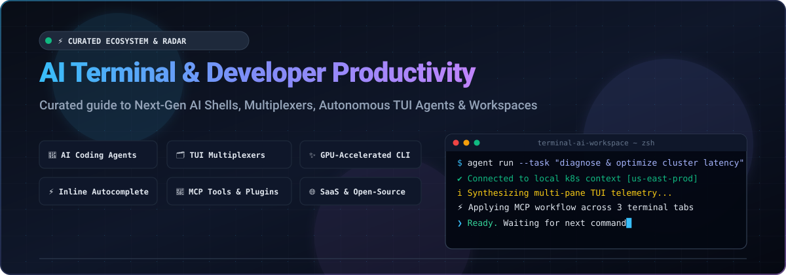

<p align="center">
  
</p>

# 🚀 Awesome AI Terminal Workspace & Developer Productivity

<p align="center">
  <a href="https://github.com/ishandutta2007/Awesome-Awesome-Awesome"></a>
  <a href="https://discord.gg/jc4xtF58Ve"></a>
  <a href="https://github.com/ishandutta2007/Awesome-AI-Terminal-Workspace-Developer-Productivity/stargazers"></a>
  <a href="https://github.com/ishandutta2007/Awesome-AI-Terminal-Workspace-Developer-Productivity/network/members"></a>
  <a href="https://github.com/ishandutta2007/Awesome-AI-Terminal-Workspace-Developer-Productivity/blob/main/LICENSE"></a>
  <a href="https://github.com/ishandutta2007"></a>
</p>

> **The Definitive, SEO-Optimized Developer Guide to Next-Gen AI Terminal Workspaces, Autonomous TUI Agents, GPU-Accelerated Multiplexers, Natural-Language Command Line Shells & Developer Productivity Ecosystems.**

*Curated radar covering both enterprise SaaS platforms and leading open-source GitHub projects.*  
**Last updated:** November 2026 ⚡

---

## 📑 Table of Contents

- [🌟 Sector Overview & Market Dynamics](#-sector-overview--market-dynamics)
- [💼 SaaS & Hosted AI Terminal Workspaces](#-saas--hosted-ai-terminal-workspaces)
- [🛠️ Open-Source GitHub Projects](#️-open-source-github-projects)
- [🏗️ Recommended Architecture & Frameworks](#️-recommended-architecture--frameworks)
- [📈 Star History](#-star-history)
- [🤝 How to Contribute](#-how-to-contribute)
- [💖 Support & Sponsorship](#-support--sponsorship)
- [📜 Disclaimer](#-disclaimer)

---

## 🌟 Sector Overview & Market Dynamics

The developer productivity software and AI-augmented developer tooling sector represents an estimated **$15B–$18B total addressable market (TAM)**, expanding rapidly at an estimated **25%+ CAGR** fueled by enterprise adoption of autonomous coding agents and terminal orchestration platforms. 

Market dynamics demonstrate a **moderately fragmented yet converging ecosystem**: foundational frontier model providers (Microsoft, Anthropic, Amazon) anchor the core agent APIs and enterprise distribution channels, while nimble specialized terminal workspace vendors (e.g., Warp, Windsurf/Codeium) and high-velocity open-source platforms compete fiercely for daily developer mindshare and command-line execution sovereignty.

---

## 💼 SaaS & Hosted AI Terminal Workspaces

*The following hosted and commercial platforms provide managed AI capabilities, team synchronization, and enterprise security policies for terminal workflows. Ranked descending by company scale (market capitalization / valuation).*

| SaaS Product | Company Scale (Valuation / Revenue) | Starting Paid Pricing | Free Tier Limits | Key Highlights & Architecture |
| :--- | :--- | :--- | :--- | :--- |
| **[GitHub Copilot CLI](https://github.com)** | **~$3.77 Trillion Market Cap** (Parent: Microsoft MSFT) | **$10/user/month** (Pro plan); **$19/user/month** (Business plan) | **2,000 code completions/month** and basic chat/CLI queries on GitHub Copilot Free; advanced cloud agents require paid subscription | Official terminal AI assistant and GitHub agent suggesting `git`/`gh` workflows, explaining complex shell syntax, and executing repo actions. |
| **[Amazon Q Developer CLI](https://aws.amazon.com/q/developer/)** | **~$2.85 Trillion Market Cap** (Parent: Amazon AMZN) | **$19/user/month** (Pro plan; includes pooled team code transformations at $0.003/extra LOC) | **50 agentic requests/month**, 1,000 lines of code transformation/month, and 50 security scans/month via AWS Builder ID | Cloud-backed AI CLI workspace providing IDE-style terminal autocomplete, natural-language-to-bash translation, and AWS infrastructure troubleshooting. |
| **[Anthropic Claude Code](https://claude.ai)** | **~$1.50 Trillion Valuation** (Anthropic NASDAQ) | **$20/month** (Pro plan); **$100/month** (Max plan); or direct API token pay-as-you-go | **No free access for Claude Code CLI tool** (CLI requires authenticated paid plan or Console API key; free web tier restricted to standard limited chat) | Agentic terminal workspace assistant that navigates multi-directory codebases, runs test suites, manages Git workflows, and executes tools via Model Context Protocol (MCP). |
| **[Atlassian Rovo Dev CLI](https://www.atlassian.com/software/rovo)** | **~$35 Billion Market Cap** (Atlassian NASDAQ: TEAM) | **$20/developer/month** (Rovo Dev Standard; 2,000 pooled credits/mo, overage at $0.01/credit) | **350 Rovo Dev credits/user/month** included only for eligible paid Jira accounts; stops executing when limit is hit (no standalone free plan) | Enterprise cloud-connected terminal workspace agent linking local shell workflows directly with Jira issues, Confluence knowledge bases, and Bitbucket PRs. |
| **[Windsurf / Codeium Command](https://windsurf.com)** | **~$1.25B - $2.85B Valuation** (~$40M - $82M+ ARR) | **$20/user/month** (Pro plan); **$40/user/month** (Teams plan) | **Unlimited tab autocompletions**, but limited light quota of multi-step agent actions/flows and access restricted to smaller base models | AI-first developer workspace featuring Cascade multi-step autonomous shell command execution, inline file edits, and terminal workspace workflows. |
| **[Warp (Warp AI & Oz Agents)](https://www.warp.dev)** | **~$500M+ Valuation** (~$16M+ ARR, $73M+ VC raised) | **$20/month** (Build plan, $18/mo billed annually); **$50/user/month** (Business plan) | **Full terminal emulator is 100% free forever** for local usage; **0 bundled managed AI credits** on Free tier (requires BYOK - Bring Your Own OpenAI/Anthropic API keys) | GPU-accelerated terminal workspace and Agentic Development Environment with block-based execution, natural-language synthesis, and shared Warp Drive notebooks. |
| **[Termius AI](https://termius.com)** | **~$30M - $50M Est. Valuation** (~$4M - $4.5M ARR) | **$10/user/month** (Pro plan, billed annually); **$20/seat/month** (Team plan) | **Free Starter plan** includes local vault and basic AI command autocomplete; **0 cross-device sync** and no shared team vaults on free tier | Cross-platform SSH/SFTP client and cloud-synced DevOps terminal workspace featuring AI command autocomplete, server log diagnostics, and team snippet vaults. |

---

## 🛠️ Open-Source GitHub Projects

*High-velocity open-source terminal workspaces, GPU emulators, multiplexers, and autonomous TUI developer agents. Sorted in descending order by GitHub stargazers.*

| Project | GitHub_Stars | License | Description |
| :--- | :---: | :---: | :--- |
| **[Anomaly / OpenCode](https://github.com/anomalyco/opencode)** | [](https://github.com/anomalyco/opencode/stargazers) | `MIT` | Polished terminal-native autonomous AI coding agent with LSP diagnostics integration, client/server architecture, and multi-provider LLM support. |
| **[Oh My Zsh](https://github.com/ohmyzsh/ohmyzsh)** | [](https://github.com/ohmyzsh/ohmyzsh/stargazers) | `MIT` | Community-driven framework for managing Zsh shell configurations, featuring 300+ plugins, themes, and shell AI assistant integrations. |
| **[Ollama](https://github.com/ollama/ollama)** | [](https://github.com/ollama/ollama/stargazers) | `MIT` | Get up and running with Llama 3, DeepSeek, Qwen, Mistral, and local open-weight models directly from the command line for local terminal AI inference. |
| **[OpenAI Codex CLI](https://github.com/openai/codex)** | [](https://github.com/openai/codex/stargazers) | `Apache-2.0` | Official open-source lightweight terminal coding agent written in Rust with OS-level sandboxing (`Seatbelt`/`Landlock`), multimodal input, and MCP support. |
| **[Gemini CLI](https://github.com/google-gemini/gemini-cli)** | [](https://github.com/google-gemini/gemini-cli/stargazers) | `Apache-2.0` | Official open-source terminal AI agent from Google bringing Gemini models, Google Search grounding, local file/shell tools, and MCP extensions to the shell. |
| **[MCP Reference Servers](https://github.com/modelcontextprotocol/servers)** | [](https://github.com/modelcontextprotocol/servers/stargazers) | `MIT` | Official Model Context Protocol (MCP) server reference ecosystem enabling terminal workspaces and agents to securely connect to Git, Docker, Postgres, and filesystems. |
| **[Tabby](https://github.com/Eugeny/tabby)** | [](https://github.com/Eugeny/tabby/stargazers) | `Alpha` | Modern, infinitely configurable cross-platform terminal and SSH/SFTP client extensible with connection management, split panes, and AI plugins. |
| **[Open Interpreter](https://github.com/openinterpreter/openinterpreter)** | [](https://github.com/openinterpreter/openinterpreter/stargazers) | `AGPL-3.0` | Natural-language interface for computers in the terminal—executing Python, JavaScript, and Bash commands locally with full system control. |
| **[Ghostty](https://github.com/ghostty-org/ghostty)** | [](https://github.com/ghostty-org/ghostty/stargazers) | `MIT` | Fast, native, GPU-accelerated cross-platform terminal emulator offering zero-latency rendering, native platform UI, splits/tabs, and high throughput for TUI agents. |
| **[Starship Prompt](https://github.com/starship/starship)** | [](https://github.com/starship/starship/stargazers) | `ISC` | Minimal, blazing-fast, and infinitely customizable prompt for any shell, providing instant Git status, runtime indicators, and command execution timings. |
| **[Block Goose](https://github.com/aaif-goose/goose)** | [](https://github.com/aaif-goose/goose/stargazers) | `Apache-2.0` | Open-source, extensible local-first AI developer agent from Block that installs tools, edits multi-file repositories, runs tests, and integrates via MCP. |
| **[Tmux](https://github.com/tmux/tmux)** | [](https://github.com/tmux/tmux/stargazers) | `ISC` | Legendary terminal multiplexer enabling detaching and re-attaching persistent terminal sessions, scripting multi-pane layouts, and running parallel background processes. |
| **[Aider](https://github.com/Aider-AI/aider)** | [](https://github.com/Aider-AI/aider/stargazers) | `Apache-2.0` | Pioneering command-line AI pair programmer that maps Git codebases, plans changes, executes multi-file diffs, runs test suites, and creates automated Git commits. |
| **[Zellij](https://github.com/zellij-org/zellij)** | [](https://github.com/zellij-org/zellij/stargazers) | `MIT` | Modern terminal workspace and multiplexer written in Rust featuring floating panes, WebAssembly plugins, persistent sessions, and intuitive TUI navigation. |
| **[k9s](https://github.com/derailed/k9s)** | [](https://github.com/derailed/k9s/stargazers) | `Apache-2.0` | Fast, terminal-based UI to interact with Kubernetes clusters, monitor pod health in real-time, view logs, and troubleshoot infrastructure instantly. |
| **[Atuin](https://github.com/atuinsh/atuin)** | [](https://github.com/atuinsh/atuin/stargazers) | `MIT` | Magical SQLite-backed shell history workspace providing end-to-end encrypted cross-machine sync, interactive full-screen TUI search, and contextual statistics. |
| **[WezTerm](https://github.com/wezterm/wezterm)** | [](https://github.com/wezterm/wezterm/stargazers) | `MIT` | GPU-accelerated cross-platform terminal emulator and multiplexer scriptable in Lua, ideal for creating highly customized developer workspaces. |
| **[Charm Crush](https://github.com/charmbracelet/crush)** | [](https://github.com/charmbracelet/crush/stargazers) | `FSL-1.1-MIT` | Glamorous terminal agentic coding environment from Charm bringing elegant TUI workflows and autonomous LLM assistance directly to the command line. |
| **[Wave Terminal](https://github.com/wavetermdev/waveterm)** | [](https://github.com/wavetermdev/waveterm/stargazers) | `Apache-2.0` | Open-source graphical terminal workspace combining traditional CLI power with inline file/web previews, persistent multi-tab layouts, and AI command blocks. |
| **[Plandex](https://github.com/plandex-ai/plandex)** | [](https://github.com/plandex-ai/plandex/stargazers) | `AGPL-3.0` | Terminal-based AI coding engine built for complex software tasks—tracks project files in sandbox branches, applies diffs, and handles multi-stage plans. |
| **[Electerm](https://github.com/electerm/electerm)** | [](https://github.com/electerm/electerm/stargazers) | `MIT` | Open-source terminal, SSH, SFTP, and serial port client with cloud sync, customizable UI themes, and command snippet automation. |
| **[ShellGPT](https://github.com/TheR1D/shell_gpt)** | [](https://github.com/TheR1D/shell_gpt/stargazers) | `MIT` | Lightweight command-line productivity tool powered by LLMs for generating shell commands, code snippets, and interactive REPL sessions in the terminal. |
| **[Inshellisense](https://github.com/microsoft/inshellisense)** | [](https://github.com/microsoft/inshellisense/stargazers) | `MIT` | IDE-style command-line autocomplete runtime from Microsoft supporting 600+ tools across Bash, Zsh, Fish, and PowerShell without cloud telemetry. |
| **[AIChat](https://github.com/sigoden/aichat)** | [](https://github.com/sigoden/aichat/stargazers) | `MIT` | All-in-one Rust CLI LLM utility featuring Shell Assistant mode, Chat REPL, RAG document search, AI agents, and integration with 20+ model providers. |
| **[Aicommits](https://github.com/Nutlope/aicommits)** | [](https://github.com/Nutlope/aicommits/stargazers) | `MIT` | CLI tool that inspects staged `git diff` outputs and automatically generates clean, standardized Conventional Git Commit messages with AI. |
| **[kubectl-ai](https://github.com/GoogleCloudPlatform/kubectl-ai)** | [](https://github.com/GoogleCloudPlatform/kubectl-ai/stargazers) | `Apache-2.0` | AI-powered Kubernetes CLI assistant from Google Cloud translating natural language intents into validated `kubectl` commands and manifests. |
| **[OpenCommit](https://github.com/di-sukharev/opencommit)** | [](https://github.com/di-sukharev/opencommit/stargazers) | `MIT` | Feature-rich Git CLI wrapper for auto-generating conventional commit messages using Claude, GPT-4, and local Ollama models. |
| **[Charm Mods](https://github.com/charmbracelet/mods)** | [](https://github.com/charmbracelet/mods/stargazers) | `MIT` | Unix-friendly command-line AI utility designed to integrate LLMs into standard shell pipes (`stdin`/`stdout`), Markdown formatters, and Bash scripts. |
| **[gptme](https://github.com/gptme/gptme)** | [](https://github.com/gptme/gptme/stargazers) | `MIT` | Autonomous terminal companion and coding agent equipped with shell execution, Python execution, web browsing, and persistent memory. |
| **[Chaterm](https://github.com/chaterm/Chaterm)** | [](https://github.com/chaterm/Chaterm/stargazers) | `AGPL-3.0` | Open-source AI terminal and SSH management tool for cloud and DevOps infrastructure automation using natural language. |
| **[Butterfish](https://github.com/bakks/butterfish)** | [](https://github.com/bakks/butterfish/stargazers) | `MIT` | Lightweight shell wrapper injecting LLM prompting and context directly into standard Bash and Zsh sessions with local or OpenAI endpoints. |
| **[ThinkTerm](https://github.com/RoversX/ThinkTerm)** | [](https://github.com/RoversX/ThinkTerm/stargazers) | `GPL-3.0` | Modern GPU-drawn terminal with built-in persistent multiplexer designed to orchestrate local shells and AI agent sessions across platforms. |

---

## 🏗️ Recommended Architecture & Frameworks

To assemble a sovereign, production-grade AI terminal workspace on your workstation:

```
┌────────────────────────────────────────────────────────┐
│            Modern Display & Window Multiplexer         │
│     Ghostty / WezTerm / Wave Terminal / Zellij / Tmux  │
└──────────────────────────┬─────────────────────────────┘
                           │
┌──────────────────────────▼─────────────────────────────┐
│          Autonomous Coding & TUI Pair-Programmer       │
│      OpenCode / Codex CLI / Claude Code / Aider        │
└──────────────────────────┬─────────────────────────────┘
                           │
┌──────────────────────────▼─────────────────────────────┐
│          Shell Productivity, History & Autocomplete    │
│      Inshellisense  +  Atuin  +  Starship  +  Mods     │
└──────────────────────────┬─────────────────────────────┘
                           │
┌──────────────────────────▼─────────────────────────────┐
│             Local Inference & Tool Protocols           │
│       Ollama (Local Models)  +  MCP Reference Servers  │
└────────────────────────────────────────────────────────┘
```

---

## 📈 Star History

[](https://www.star-history.com/#ishandutta2007/Awesome-AI-Terminal-Workspace-Developer-Productivity&type=date&legend=top-left)

---

## 🤝 How to Contribute

Contributions are warmly welcomed! Help keep this ecosystem guide fresh, accurate, and comprehensive:

1. 🍴 **Fork** this repository.
2. 🌿 Create a feature branch: `git checkout -b feature/add-new-tool`.
3. 📝 Add your entry to either the **SaaS** or **Open-Source** table (maintaining alphabetical or star/valuation order, and including pricing/free tier or Stars_Badges).
4. 🚀 Commit your changes: `git commit -m "Add [Tool Name] to AI Terminal Workspace list"`.
5. 📬 Push to the branch and submit a **Pull Request**.

---

## 💖 Support & Sponsorship

If you find this repository valuable for your daily engineering workflow or terminal productivity, please consider supporting the project:

- ⭐ **Star this repository** to help others discover it on GitHub.
- 🍴 **Fork and share** it with your engineering team, DevOps group, or developer community.
- ☕ **Sponsor or Buy a Coffee:** Support ongoing maintenance, research, and curation directly via the [GitHub Sponsors Dashboard](https://github.com/sponsors/ishandutta2007).

---

## 📜 Disclaimer

*This repository is curated independently for informational and developer productivity purposes. All product names, logos, trademarks, and registered trademarks belong to their respective owners. Mention of SaaS or open-source products does not constitute formal endorsement.*
